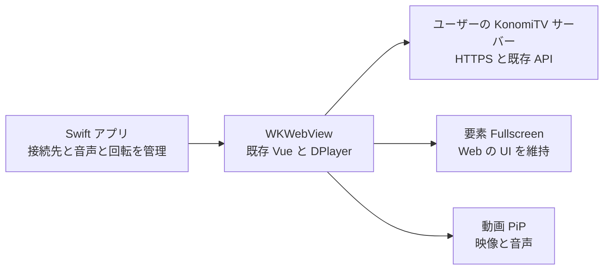

# KonomiTV iOS ラッパーアプリの実現性と実装方針

2026年10月13日の実機検証を受け、ホーム移動時の自動 PiP は採用しない。端末内で HLS へ組み替える試験実装も撤去し、既存 Web プレイヤーと手動 PiP を利用する。従来の全画面ボタンは横画面固定へ置き換え、ネイティブの画面回転と KonomiTV の通常の横画面レイアウトを利用する。WebKit の Fullscreen API は無効化する。セーフエリアと、WebKit と競合する音声セッションの有効化を避ける修正は維持する。以下は当初の検討記録であり、要素 Fullscreen と AVPlayer への移管案は現在の採用方針に含めない。

2026年10月14日、下端はホームバー領域まで描画するよう変更する。上端と左右のセーフエリアは維持し、視聴画面の Web UI が確保する下端の余白も削除する。

KonomiTV の既存 Web UI とプレイヤーを Swift 製の WKWebView アプリで包み、iPhone のフルスクリーンと Picture-in-Picture（以下 PiP）を提供する方針は、公開 API による実現経路があるため検証へ進められる。フルスクリーンは公式の実装根拠があり、PiP は KonomiTV の実配信がバックグラウンドで継続することを確認できれば採用できる。第一案は **Swift と WKWebView の公開 API を使い、既存の再生処理を維持する構成**とする。AVPlayer への再生移管は、実機検証で問題が残った場合の拡張案とする。

フルスクリーンには Apple が公開した要素 Fullscreen の許可設定があり、PiP にも WKWebView の許可設定がある。ただし、設定だけで KonomiTV のライブ配信がバックグラウンドで継続するとは保証できない。**ライブと録画の両方で、フルスクリーン操作と長時間の PiP 再生が成立することを採用条件にする。**

検討基準日は 2026年10月12日。対象は master の [コミット 0775594](https://github.com/tsukumijima/KonomiTV/commit/07755942152b312a23ffb14b2877cd01ea48e62f) で、client/package.json のバージョン表記は 0.14.1。初期検証では iPhone を主対象とし、iPad は回帰確認の対象とする。アプリの実装および実機での動作確認は、この実現性検討の後に行う。

## 現行 KonomiTV の再生方式と制約

KonomiTV は Vue の画面と DPlayer を使う Web アプリで、再生の中心は PlayerController.ts にある。iOS の最低要件は README 上では 17.1。ライブの旧 LL-HLS 方式は廃止され、ManagedMediaSource を利用する mpegts.js 方式へ移行している。README には、iPhone Safari の Fullscreen と PWA の PiP の制約に加え、iOS の Chrome など WKWebView 環境はサポート対象外と記載されている。このため専用アプリは、独立した動作検証とサポートが必要になる。[KonomiTV README](https://github.com/tsukumijima/KonomiTV/blob/07755942152b312a23ffb14b2877cd01ea48e62f/Readme.md)

| 再生対象 | 現行の主な経路 | ラッパー実装での意味 |
| --- | --- | --- |
| ライブの通常画質 | 連続 MPEG-TS → mpegts.js → MediaSource 系 → video 要素 | 既存経路を再利用できる可能性がある。PiP 中の通信とバッファ供給を確認する |
| 録画の通常画質 | HLS プレイリスト → hls.js → MediaSource 系 → video 要素 | セグメント取得に加え、再生セッションの維持を確認する |
| Original MPEG-2 画質 | mpeg2toh264 を使う別経路 | 最初の検証を通常画質で行い、この経路の対応可否は別に評価する |

上記は [PlayerController の画質と URL の構築](https://github.com/tsukumijima/KonomiTV/blob/07755942152b312a23ffb14b2877cd01ea48e62f/client/src/services/player/PlayerController.ts#L406) に基づく。ライブと録画では配信方式が異なるため、片方だけ動作しても両機能への対応完了とはしない。

既存のフルスクリーン処理は、video 要素だけでなく **document.body 全体**を requestFullscreen または webkitRequestFullscreen で表示し、PlayerStore の is_fullscreen に状態を反映する。この経路を動作させれば、KonomiTV の操作 UI、コメント、字幕を含む Web 画面を維持できる。[setupFullscreenHandler](https://github.com/tsukumijima/KonomiTV/blob/07755942152b312a23ffb14b2877cd01ea48e62f/client/src/services/player/PlayerController.ts#L1866)

## フルスクリーンと PiP の実現根拠

### WKWebView の要素フルスクリーン

WKPreferences.isElementFullscreenEnabled を true にすると、WKWebView 内の HTML 要素に Fullscreen API を許可できる。公開 API は iOS 15.4 以降で利用でき、Apple の WWDC22 には iPhone 上で HTML 要素をフルスクリーンにする例がある。Safari の制約を、そのまま専用 WKWebView アプリの制約とみなす必要はない。[Apple API](https://developer.apple.com/documentation/webkit/wkpreferences/iselementfullscreenenabled)、[WWDC22 の説明とコード](https://developer.apple.com/videos/play/wwdc2022/10049/)

第一にこの設定で既存の body 全体のフルスクリーン処理を試す。映像だけを標準プレイヤーへ移す video.webkitEnterFullscreen は、Web のコメントや操作 UI を維持する要件と別に扱う。

OS 差は残る。WebKit は Safari 18.3 で、許可設定を有効にしても iOS の WKWebView がフルスクリーンへ入れない問題を修正したと公表している。**初期対応 OS の候補は iOS 18.3 以降**とし、実機結果をもとに確定する。KonomiTV 本体の最低要件 17.1 と、ラッパーアプリの動作保証範囲は分ける。[WebKit Safari 18.3 の修正](https://webkit.org/blog/16439/webkit-features-in-safari-18-3/)

### WKWebView の動画 PiP

WKWebViewConfiguration.allowsPictureInPictureMediaPlayback は HTML5 動画の PiP を許可する公開設定で、既定値も true。インライン表示には allowsInlineMediaPlayback を true にし、HTML 側の playsinline も使う。アプリ側では Background Modes の Audio, AirPlay, and Picture in Picture と、適切な AVAudioSession の再生カテゴリを設定する。[PiP の設定](https://developer.apple.com/documentation/webkit/wkwebviewconfiguration/allowspictureinpicturemediaplayback)、[インラインの設定](https://developer.apple.com/documentation/webkit/wkwebviewconfiguration/allowsinlinemediaplayback)、[Apple のメディア再生設定](https://developer.apple.com/documentation/avfoundation/configuring-your-app-for-media-playback)、[WKWebView の PiP 対応](https://developer.apple.com/library/archive/documentation/WindowsViews/Conceptual/AdoptingMultitaskingOniPad/QuickStartForPictureInPicture.html)

PWA の問題は WebKit Bug 303885 に具体的な再現報告があり、同じ端末とページでも Safari と Home Screen アプリで結果が異なる。専用 WKWebView には PiP を許可する経路があるため、回避策として合理性がある。ただし document.pictureInPictureEnabled が true でも PWA では失敗する報告があり、フラグや API の存在だけでは成功を判定しない。[WebKit Bug 303885](https://bugs.webkit.org/show_bug.cgi?id=303885)

ここで対象とするのは **映像と音声の PiP**。Web ページ全体を別ウィンドウに移す Document Picture-in-Picture とは区別する。KonomiTV のコメントや ARIB 字幕は別 DOM や Canvas に描画されるため、そのまま動画 PiP に含まれることは想定しない。Original 画質の Canvas によるデインターレースも、PiP に反映されない可能性が既存コードに記されている。[Original 画質の PiP 制約](https://github.com/tsukumijima/KonomiTV/blob/07755942152b312a23ffb14b2877cd01ea48e62f/client/src/services/player/PlayerController.ts#L728) PiP でもこれらの表示が必須なら、追加の合成処理を別要件として設計する。

## 採用するアプリ構成

Swift と WKWebView を使い、ユーザーが登録した KonomiTV サーバーの HTTPS URL を読み込む。番組表、録画一覧、視聴画面、設定は既存 Web UI を使い、ネイティブ側は接続先設定、WebView の保持、画面回転、音声セッションなどを担当する。iOS のみを対象にした最小構成として、Apple の設定を直接扱える Swift を選ぶ。

最初は Web クライアントをアプリへ同梱せず、サーバー配信の画面をそのまま利用する。これにより画面と API の組み合わせをサーバーのバージョンに揃え、既存の同一オリジンの通信や認証処理を再利用する。



WKWebView 作成前の設定例は次のとおり。これは構成を説明するコードであり、完成したアプリの実装ではない。

```swift
let configuration = WKWebViewConfiguration()
configuration.websiteDataStore = .default()
configuration.allowsInlineMediaPlayback = true
configuration.allowsPictureInPictureMediaPlayback = true
configuration.preferences.isElementFullscreenEnabled = true

let webView = WKWebView(frame: .zero, configuration: configuration)
```

Xcode では Background Modes の Audio, AirPlay, and Picture in Picture を有効にする。AVAudioSession には .playback と .moviePlayback を設定し、有効化は再生開始のタイミングで行う。音声割り込みや出力先の変化も扱う。

WebView は画面の再描画やアプリのバックグラウンド移行で作り直さない。PiP 再生中に load、reload、プレイヤー破棄を行うと、再生の連続性を失う。WebKit がフルスクリーン遷移で WebView の階層を変更することも踏まえ、ネイティブのツールバーが必ず重なって表示される構成にはしない。

## 必要な改修と実装上の注意

| 対象 | 方針 |
| --- | --- |
| ネイティブアプリ | 接続先 URL の登録と保存、永続 WebView、Fullscreen と PiP の許可設定、音声設定を実装する |
| PlayerController のフルスクリーン | 既存処理を先に検証し、失敗時の通知、終了イベント、is_fullscreen の同期を確認する |
| PiP ボタン | Web のタップ処理から、再生中の video 要素へ直接 PiP を要求する。対応 API は機能検出で選ぶ |
| 状態の連携 | 必要な場合に限り、PiP 状態やネイティブの回転要求を小さなブリッジで連携する |
| 通常再生と復帰 | バックグラウンド移行時の停止処理、画質切り替え、プレイヤー破棄、視聴画面への復帰を確認する |
| サーバー | 第一案では既存の配信 API を使う。セッション維持に問題があれば、その原因を切り分けて改修する |

現行 DPlayer の PiP ボタンは、document.pictureInPictureEnabled と標準の requestPictureInPicture を使い、非対応ならボタンを隠す。専用 WKWebView ではこの経路を先に確認し、必要なら webkitSupportsPresentationMode と webkitSetPresentationMode による動画 PiP を追加する。開始失敗も捕捉して案内する。[DPlayer の PiP 処理](https://github.com/tsukumijima/DPlayer/blob/v1.33.2/src/ts/controller.ts#L268)

まずネイティブ設定だけで現行 Web クライアントが動作するかを試し、PiP や機能判定の修正が必要な場合は KonomiTV の Web クライアント側へ反映する方針とする。アプリ側のスクリプト注入による既存コードの書き換えは、サーバー更新時の互換性維持が難しいため、継続運用の基本構成にはしない。したがって、厳密に外枠だけの変更で完結するかは、この検証で確定する。

PiP は最初に **アプリ表示中にボタンを押して開始し、その後 Home に戻る**動作を実装する。ネイティブボタンから非同期に evaluateJavaScript を呼んでも、Web のユーザー操作権限が引き継がれるとは限らない。Home へ戻る際の自動 PiP は、明示的なボタン操作とは別の追加機能として検証する。

画質切り替えでは video 要素が交換されるため、切り替え完了後の新しい要素へ PiP のイベントを登録し直す。PiP 中の画質変更や番組変更では、PiP を終了して切り替えるなどの動作を決めておく。視聴ルートの変更や unmount はプレイヤーの破棄につながるので、PiP からの復帰では元の視聴ルートと WebView を保持する。[video 要素の交換](https://github.com/tsukumijima/KonomiTV/blob/07755942152b312a23ffb14b2877cd01ea48e62f/client/src/services/player/managers/DocumentPiPManager.ts#L244)

横向きへの固定は、Fullscreen が動いたことだけでは保証できない。既存コードは screen.orientation.lock の失敗を無視するため、必要なら公開 UIKit API と対応する画面方向の設定で補う。フルスクリーン終了、PiP 復帰、OS の回転ロック、Safe Area も一緒に確認する。

既存の Utils.isSafari は User-Agent の Safari 文字列に依存するため、既定の WKWebView では Safari 用のバッファ補正や HEVC 判定に差が出る。applicationNameForUserAgent でアプリ名を付けるだけでは、この判定は修正されない。専用アプリの環境情報と API の機能検出を使って必要な分岐を明示し、mpegts.js 側の判定も確認する。[Safari 判定](https://github.com/tsukumijima/KonomiTV/blob/07755942152b312a23ffb14b2877cd01ea48e62f/client/src/utils/Utils.ts#L338)、[HEVC の判定](https://github.com/tsukumijima/KonomiTV/blob/07755942152b312a23ffb14b2877cd01ea48e62f/client/src/utils/PlayerUtils.ts#L195)

**PiP を開始できることと、配信を継続できることは別に検証する。** ライブでは JS による MPEG-TS の受信、変換、バッファ追加が継続する必要がある。録画では 5 秒間隔の Keep-Alive が実装されているが、Worker はメインスレッドへ通知し、実際の API 呼び出しはメインスレッドで行われる。サーバーのセッションタイムアウトは 10 秒で、プレイリストやセグメントの取得でも維持される。長い先読みや一時停止で取得が途切れる場合も含め、セッションが失効しないことを確認する。Background Modes の設定だけで、すべての JavaScript や Worker が常時実行されるとは想定しない。[Keep-Alive 呼び出し](https://github.com/tsukumijima/KonomiTV/blob/07755942152b312a23ffb14b2877cd01ea48e62f/client/src/services/player/PlayerController.ts#L1324)、[Worker タイマー](https://github.com/tsukumijima/KonomiTV/blob/07755942152b312a23ffb14b2877cd01ea48e62f/client/src/utils/Utils.ts#L432)、[10 秒のタイムアウト](https://github.com/tsukumijima/KonomiTV/blob/07755942152b312a23ffb14b2877cd01ea48e62f/server/app/streams/VideoStream.py#L84)

録画の維持リクエストだけに問題がある場合は、再生対象と画質と session_id を同期したネイティブ側の維持処理、またはサーバー側の維持方式を評価する。ただし、維持リクエストを補っても、ライブの受信や MediaSource へのバッファ供給が止まる問題は解決しない。

## 接続設定と既存機能の扱い

接続先は、ユーザーの KonomiTV が提供する正規の HTTPS URL を使う。証明書エラーを無条件で許可する処理や、TLS 検証の無効化は入れない。永続の WKWebsiteDataStore を使い、アプリ再起動後もログイン状態や設定を維持する。Safari や既存 PWA の保存領域とは別になるため、初回ログインが必要になる。

サーバー画面以外のリンクは、必要に応じて外部ブラウザで開く。ネイティブブリッジを追加する場合は、登録したサーバーのオリジンとメインフレームに対象を限定し、メッセージの型と引数を検証する。

ネイティブの接続確認やサーバー自動検出を追加する場合は、ローカルネットワーク権限と Bonjour 宣言の必要性を通信方式ごとに確認する。WKWebView の通信とネイティブの URLSession や Bonjour を一律に扱わない。[Apple TN3179](https://developer.apple.com/documentation/technotes/tn3179-understanding-local-network-privacy)

最初の対応範囲は、通常画質のライブ、通常画質の録画、Web UI を含むフルスクリーン、映像と音声の PiP とする。H.264 の通常画質から検証を始め、HEVC、24fps モード、Original MPEG-2 画質、オフライン保存再生、PiP 中のコメントと字幕合成、Home 移行時の自動 PiP は、基本構成の成立後に評価する。既存設定が Original 画質を選んでいる場合もあるため、検証時には通常画質を明示的に選び、製品では未対応機能を適切に案内する。

## 実機検証と採用判定

まず静的な MP4 または HLS のテスト動画で Fullscreen と PiP のアプリ設定を確認し、次に KonomiTV の通常画質のライブと録画で同じ操作を確認する。これにより、WebView の設定、KonomiTV のプレイヤー、配信経路の問題を切り分ける。

iPhone では初期対応 OS の候補と現行安定版を含む複数の OS と端末を使う。iPad でも通常再生と既存操作に影響がないことを確認する。17.1 系まで対応を広げる場合は、専用の検証枠を追加する。PiP の最終判定は実機で行う。

| 検証 | 合格条件 |
| --- | --- |
| 接続と認証 | 接続先を登録でき、再起動後もログインと設定が保持される |
| インライン再生 | ライブと録画が Web の視聴画面内で再生される |
| フルスクリーン | 既存ボタンで開始と終了ができ、操作 UI とコメントと字幕が維持される |
| 状態と回転 | is_fullscreen が実画面に一致し、回転と終了後のレイアウトが崩れない |
| 明示的な PiP | タップで開始し、映像と音声が表示される。失敗時は画面へ理由を返す |
| バックグラウンド継続 | PiP 開始後に別アプリへ移り、ライブと録画の双方を各 10 分以上継続できる |
| 再生操作と復帰 | 録画 PiP を 30 秒以上一時停止して再開でき、PiP 終了後に元の視聴画面へ復帰できる |
| 画質と番組の切り替え | PiP の終了や再確立を含め、二重再生や無音、古い動画の残留が起きない |
| 通信と音声の変化 | Wi-Fi とモバイル回線の切り替え、音声割り込み後に適切に復帰できる |

10 分は初期の合否判定に使う時間であり、製品化時には通常の長時間視聴でも確認する。API 呼び出しの成功ログだけではなく、映像、音声、通信、サーバーの視聴セッションが継続していることを見る。

**両配信方式で合格した場合は、WKWebView の薄いラッパーを採用する。** 全画面だけに問題が残る場合は表示方法の代替を評価する。PiP の配信継続に問題が残る場合は、次のネイティブ再生案を検討する。

## 問題が残った場合の代替構成

| 構成 | 利点 | 追加負担と判断条件 |
| --- | --- | --- |
| WKWebView の要素 Fullscreen と動画 PiP | Web UI と再生経路を最も多く再利用できる | 第一案。実ストリームのバックグラウンド継続が採用条件 |
| ネイティブの画面制御と Web の全画面レイアウト | 要素 Fullscreen に依存せず Web UI を画面全体へ広げられる | Fullscreen だけ失敗する場合の候補。状態、Safe Area、終了操作を別実装する。PiP の停止問題は解決しない |
| WKWebView と AVPlayer の併用 | ネイティブの再生と PiP 管理を使える | 配信方式、状態同期、字幕とコメントの扱いに追加設計が必要 |

AVPlayer は、JavaScript の MediaSource の内部状態や blob URL を受け取って、そのまま再生を引き継ぐ仕組みではない。録画では既存の HLS を候補にできるが、AVPlayer での互換性、セッション維持、認証、シーク、音声選択を検証し、必要に応じて配信側を調整する。Web とネイティブで同時に再生せず、再生主体を明確に切り替える。[AVPlayer](https://developer.apple.com/documentation/avfoundation/avplayer)

ライブの通常画質は連続 MPEG-TS 配信なので、AVPlayer の HLS 再生へ移す場合は、新しい HLS または LL-HLS の配信経路が必要になる。録画の HLS が存在することだけではライブの問題を解決できない。LL-HLS にはプレイリストや部分セグメントなどのサーバー実装が必要で、遅延、チャンネル切り替え、エンコーダー共有への影響も評価する。[Apple の LL-HLS](https://developer.apple.com/documentation/http-live-streaming/enabling-low-latency-http-live-streaming-hls)

AVSampleBufferDisplayLayer と AVPictureInPictureController を使う独自再生経路もあるが、データの分離、時刻管理、映像と音声の同期、再生制御を実装する必要がある。この案は薄いラッパーの規模を超えるため、HLS の代替まで不適切な場合に検討する。[WWDC21 の AVKit](https://developer.apple.com/videos/play/wwdc2021/10290/)

## 実装と配布の進め方

1. **最小アプリで機能を確認する。** 接続先登録、単一の WKWebView、Fullscreen と PiP の許可設定、音声設定を実装し、テスト動画で確認する。
2. **KonomiTV の実配信で採否を決める。** 通常画質のライブと録画で実機検証を行い、必要な Web 側の修正を特定する。PiP のバックグラウンド継続に失敗する場合は、配信方式を広げる前に原因を切り分ける。
3. **利用に必要な部分を仕上げる。** 接続エラー、回転、復帰、音声割り込み、未対応機能の案内を整え、対応 OS と KonomiTV のバージョン範囲を確定する。
4. **配布する。** PoC は Xcode から実機へ導入する。テスターへの配布には TestFlight を使い、正式公開する場合は App Store 審査へ進む。

App Store の Guideline 4.2 は、Web サイトの再包装を超える機能を求める。フルスクリーン、PiP、接続設定、復帰操作などの具体的な利用価値を審査で説明し、審査担当者が利用できる接続先とテスト用コンテンツを用意する。技術的に動作することと審査の承認は別の判断になる。[Apple App Review Guidelines](https://developer.apple.com/app-store/review/guidelines/)

最初の実装判断は、**Swift と WKWebView の公開機能による最小 PoC に進む**こととする。既存 UI と配信経路を使った両機能の成立を確認してから、正式対応範囲と追加改修を確定する。

